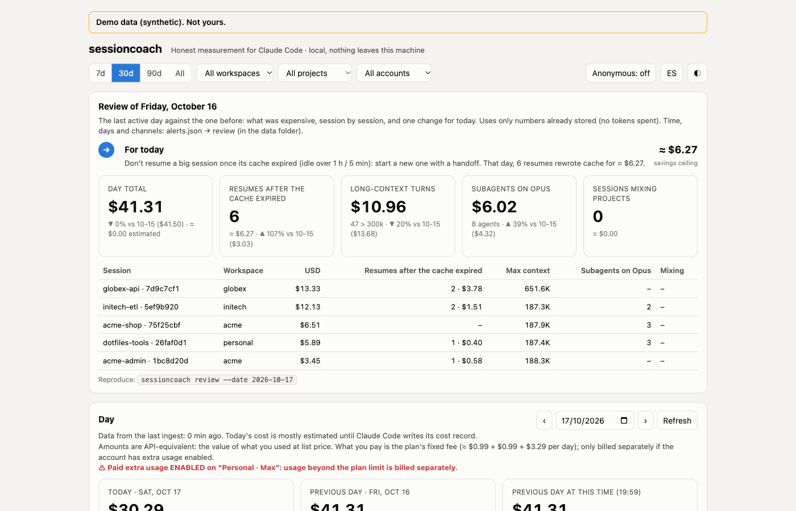
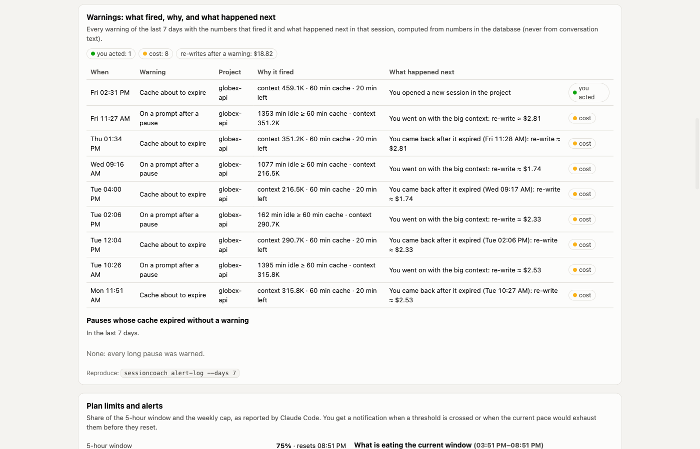
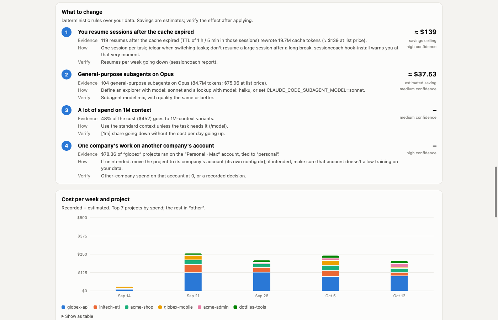

# sessioncoach

**Is your Claude Code setup worth it?** sessioncoach is a command-line tool with a local dashboard. It measures what
Claude Code really costs you, shows where the money goes, and tells you what to change, with the evidence, the
expected saving (always labelled as an estimate) and how to check afterwards that it worked.

- **Stop paying for a cold cache.** After a long pause, the next prompt writes the whole context to the cache again:
  about $4 for a 500k-token session on Opus. sessioncoach warns you before that happens (or holds the prompt back), so
  you can start a clean session from a handoff instead.
- **Local only.** It reads Claude Code's transcripts on your machine and keeps metadata (token counts, models, times,
  ids, project and tool names) in a local SQLite file, never the content of your sessions. No server, no account, no
  telemetry.
- **Standard library only.** Python 3.9+, nothing else to install.



<details><summary>More screenshots (synthetic data, <code>sessioncoach demo</code>)</summary>





</details>

> **Dollars are API-equivalent.** Figures are what the same tokens cost at Anthropic's API prices. On a Pro or Max
> subscription you do not pay that: read them as how much of your plan's limits a habit burns, and compare them with
> each other, not with your invoice.

Status: early preview (0.1.0); interfaces may change. sessioncoach reads Claude Code's local transcripts, an internal
format that Claude Code does not document and may change; `sessioncoach verify` shows how much of it it could read.
Works on macOS and Linux (and WSL). Windows support is experimental: covered by tests and CI, not yet used day to day
(reports welcome).

## Install

You need Python 3.9+, Git and Claude Code. sessioncoach is not on PyPI yet: install it from GitHub with
[pipx](https://pipx.pypa.io).

| System | Install |
|---|---|
| macOS | `brew install pipx && pipx ensurepath` |
| Linux / WSL | `python3 -m pip install --user pipx && python3 -m pipx ensurepath` (or your distro's `pipx` package) |
| Windows (PowerShell) | `py -m pip install --user pipx; py -m pipx ensurepath` |

Open a new terminal (so `pipx ensurepath` takes effect), then:

```bash
pipx install git+https://github.com/macurandb/sessioncoach
```

Or run it from a clone, with no install: `git clone https://github.com/macurandb/sessioncoach` and use
`bin/sessioncoach` wherever this page says `sessioncoach`.

## First result in two minutes

```bash
sessioncoach setup       # guided: asks about each piece, says what it gives you first (--yes takes the defaults)
sessioncoach ingest      # read your transcripts now (setup schedules it from then on)
sessioncoach report      # where your money goes and what to change first, in the terminal
sessioncoach dashboard   # the same in your browser; stays running until Ctrl+C
sessioncoach check       # verify what setup installed (read-only)
```

`setup` offers each piece separately and none of them is required:

- a scheduled `ingest`, every 30 minutes, so your history outlives Claude Code's 30-day transcript retention;
- the **resume warning**: before a prompt writes a big expired cache again, it tells you what that costs and what to
  type instead (shown to you, never to the model);
- plan limits and alerts in the **status line** (chained after your own status line, which keeps running);
- a **daily review**: yesterday's numbers and one change for today, as a notification and in the dashboard;
- **`/handoff`**: Claude writes the state of the session to `docs/HANDOFF-<date>-<topic>.md`, and after `/clear` the
  new session starts from it by itself;
- the **idle guard** (off unless you choose it): the first prompt after a pause of an hour or more is held back, so
  nothing is spent until you decide.

`sessioncoach dashboard` opens `http://127.0.0.1:8787/?k=<secret>` and prints the link. The secret is new each time
the dashboard starts: open the printed link again after a restart.

## Day to day

Once set up, there is nothing to run. Claude Code shows the warnings, the status line and the notifications; the
daily review arrives on weekdays at 08:00. When you want detail:

- `sessioncoach dashboard`: cost, causes, recommendations, warnings and limits;
- `sessioncoach review`: one change for today, from your last active day;
- `sessioncoach day`: today against yesterday, per account and project;
- `/handoff` in a big session before stepping away, then `/clear` when you come back.

## Uninstall

```bash
sessioncoach uninstall --all        # hooks, status line, /handoff and scheduled jobs, in every settings scope
pipx uninstall sessioncoach         # the tool itself
```

Run `uninstall --all` from each project where you ran `setup --scope project`. Your data in `~/.sessioncoach` stays
unless you add `--purge`; handoff files in your projects are yours and stay too.

## Commands

`sessioncoach help` lists them all; `sessioncoach help <command>` adds the options, the files it writes and how to
undo it.

<details><summary>All commands</summary>

| Command | What it gives you |
|---|---|
| `ingest` | Keeps your history after Claude Code deletes its transcripts (30 days by default); setup schedules it. |
| `report` | Where your money goes and what to change first, in the terminal. |
| `day` | Catch an expensive day early: today against yesterday, per account and project. |
| `tools` | Find out whether exploration or one MCP server is eating your turns. |
| `verify` | How far to trust the cost figures before you act on them. |
| `statusline` | The command Claude Code runs to draw the status line (statusline-install sets it up). |
| `statusline-install` | See a plan limit coming before it stops you: limits and alerts in the status line. |
| `statusline-uninstall` | Give the status line back to your own command alone. |
| `hook` | The entry point Claude Code runs for sessioncoach's hooks: the resume warning (prompt), the handoff after /clear (session-start), Claude Code's idle summary (pre-compact) and /keep-context (keep-context). |
| `hook-install` | Decide before a prompt re-reads a big context whose cache expired, not after paying for it. |
| `hook-uninstall` | Stop the resume warning. |
| `alerts` | How close you are to the 5-hour and weekly limits and to your budgets. |
| `alert-log` | Whether the warnings help: what each said, why, and what you did next. |
| `review` | One change for today from yesterday's numbers, with no tokens spent. |
| `review-install` | Get the daily review without remembering to ask for it. |
| `review-uninstall` | Stop the scheduled daily review. |
| `setup` | Everything working in two minutes; each piece is optional and reversible. |
| `check` | Know that what sessioncoach installed still works, and how to fix what does not. |
| `uninstall` | Undo what setup did, here and in every settings scope; your data stays unless you ask. |
| `ingest-install` | Never lose history to transcript retention: ingest runs on its own. |
| `ingest-uninstall` | Stop the scheduled ingest (your data stays). |
| `handoff-install` | Pick up a paused session without paying for its context on every message: /handoff writes the state down and you go on in a clean session. |
| `handoff-uninstall` | Remove the /handoff command. |
| `resume-hook-install` | After /clear, the new session starts from your latest handoff by itself: nothing to copy or retype. |
| `resume-hook-uninstall` | Stop loading the latest handoff after /clear. |
| `idle-guard-on` | The first message after a long pause costs nothing until you choose: send it again to go on, or /clear to start clean with a free automatic handoff; /keep-context keeps a session whole when you need it. |
| `idle-guard-off` | Back to the warning alone: a prompt after a long pause is sent as you typed it. |
| `idle-compact` | Whether CLAUDE_CODE_IDLE_COMPACT_MIN_TOKENS pays off lowered to 100k or raised to 400k for you, and whether it is set right. |
| `dashboard` | Cost, causes and recommendations at a glance, in your browser (local only). |
| `demo` | Try the dashboard or take screenshots without showing your own data. |
| `version` | Which version you run, for a bug report. |
| `help` | What each command saves you, before its syntax. |

</details>

## Questions and problems

- **`sessioncoach: command not found` after installing.** Open a new terminal; `pipx ensurepath` changes your
  `PATH` for new shells only.
- **The dashboard says 401.** Open the link `sessioncoach dashboard` printed in this run; links of earlier runs stop
  working when the dashboard stops.
- **The dashboard cannot start: port in use.** `sessioncoach dashboard --port 8790`, or `--port 0` for any free port.
- **The report is empty.** Run `sessioncoach ingest`. Transcripts are read from `~/.claude/projects` (or
  `$CLAUDE_CONFIG_DIR/projects`); see [accounts](docs/accounts-and-workspaces.md) if you use more than one.
- **`check` says no scheduler was found.** Containers and WSL without systemd or cron have none: run
  `sessioncoach ingest` yourself, at least every few days.
- **No desktop notifications on macOS.** Allow notifications for **Script Editor** in System Settings →
  Notifications, then try `sessioncoach alerts --test`.
- **The figures are much higher than my subscription.** They are API-equivalent: see the note above.
- **`check` exit codes.** 1 when something is broken, 0 otherwise, including when there are only warnings.

## Guides

- [Handoffs, the idle guard and /keep-context](docs/handoff-and-idle-guard.md): what a pause costs and every option.
- [Plan limits, alerts and the daily review](docs/alerts-and-review.md): thresholds, budgets, notifications, email.
- [Projects, companies and Claude accounts](docs/accounts-and-workspaces.md): `projects.json`, `accounts.json`, one
  account per project.
- [How sessioncoach measures](docs/how-it-measures.md): the cost model, what each figure means, demo and anonymous
  mode.
- [The settings panel](docs/settings-panel.md): turning practices on and off from the dashboard, per scope.
- [Scheduling, platforms and upgrading](docs/scheduling-and-platforms.md): schedulers per system, Windows, the old
  `kit` name.
- [Privacy and security](docs/privacy-and-security.md): exactly what is stored, what reaches the model, the
  dashboard's protections.

## Development

See [CONTRIBUTING.md](CONTRIBUTING.md) (uv, ruff, coverage ≥ 85 %; standard library only). Tests use synthetic data
only and never touch your `~/.claude`:

```bash
uv sync && uv run ruff check && uv run coverage run -m pytest -q && uv run coverage report
python3 -m unittest discover -s tests      # without uv
```

`scripts/leakcheck.py` checks that no string from a private list kept outside the repo got in
(`SESSIONCOACH_PRIVATE_STRINGS=/path/to/list`); without a list it does nothing.

Roadmap: isolated workspaces for people working with several clients; later, OpenTelemetry export, a team view
(metrics only) and an optional Docker image of the dashboard.

## License

Apache License 2.0 (see [LICENSE](LICENSE) and [NOTICE](NOTICE)). Copyright 2026 macurandb.

sessioncoach is an independent project, not affiliated with or endorsed by Anthropic. Claude and Claude Code are
trademarks of Anthropic, PBC.
