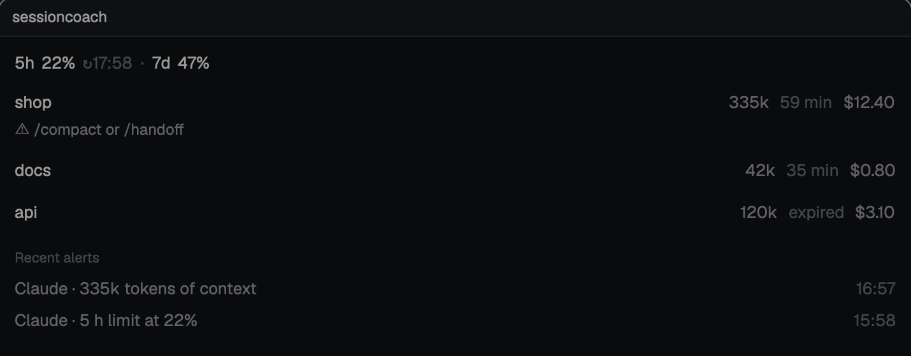

# The Herdr panel

A small panel for [Herdr](https://herdr.dev) that turns the running Claude Code sessions into a
decision view: am I OK this week, and what should I do right now — from `sessioncoach live --json`.



## What it shows

Top to bottom:

- **The verdict.** One block per account (usually one; a header names the account only when there
  are two or more). The week line is the headline — `Week 53% · at this pace 73% by Thu 21:00 ✓ on
  track` — with a verdict mark in the theme colours: red `✗ hits 100% Wed 14:00` when the current
  pace hits the limit before it resets, amber `≈ tight` when the projection reaches 90 %, green
  `✓ on track` otherwise, and no mark (`Week 53% · resets Thu 21:00`) when there is no projection
  yet. Under it, the 5-hour line — `5 h 12% · ✗ 100% at 12:10 · resets 13:30` (the red hit time and
  the reset time together) when the 5-hour pace is too fast, or just `5 h 12% · resets 13:30` — and
  a dim dollars line (`$1535 this week · $13 today`).
- **NOW.** At most three actions, the biggest-context sessions first by their rewrite cost:
  `/compact now in <project> — each turn re-reads 0.8% of the week · cache expires in 12 min` while
  the cache is alive (the per-turn clause is dropped when the turn cost is unknown), or `Don't
  resume <project> (908k, idle 46 h): coming back costs 3.2% of the week · on return, /clear gives
  a free handoff` once it has expired. When the account has no price-per-point, the same advice in
  dollars (`costs ~$18`); when the automatic handoff is not available, the promise becomes `· close
  it or start fresh`. Click a row to focus its terminal. With nothing to do, one dim line
  `Nothing urgent`.
- **Clients.** Folded by default: one row per client of the current login (the account with the
  most sessions), `label · week % · 5 h %`, from the account's own window spend — so the rows add
  up to the verdict's windows, never mixed across accounts.
- **Sessions (N).** Folded: the running sessions — project, context (`335k`), how long the cache
  has left (`42 min`, or `expired`) and today's spend (`$12.40`) — click to focus, the active
  space's first, each ordered by recent activity.
- **Alerts.** Folded: the last five alert events, newest first. New warnings keep arriving as
  toasts exactly as before.

The fold state of each section is kept in one shared key (`sessioncoach.folded`). With no Claude
Code session running, the panel says so; with no data yet it is empty.

## Install

```bash
sessioncoach herdr-install
```

It copies four files into `<app home>/mods/sessioncoach/` and writes a `config.json` next to them.
The app home is `$HERDR_APP_HOME` if set, otherwise `~/.config/herdr-app`; `--app-home DIR` overrides.
Herdr docks the panel on the right the next time it starts and finds the new folder. To open it
right away, or again after closing it, split it next to the current pane:

```bash
herdr-app do pane.split '{"direction":"right","mod":"sessioncoach"}'
```

It is a pane like any other: drag, resize or close it. There is no tab-bar button (Herdr's tab bar
only has Files and Changes).

```bash
sessioncoach herdr-uninstall
```

removes only what the installer put there — the panel's files, its `config.json` and its manifest —
and the folder, if nothing else is left. Re-running `herdr-install` is safe: it refreshes the
managed keys and keeps yours, and refuses (unless `--force`) to overwrite a panel that was edited or
not installed by sessioncoach. An install made before `logic.js` was shipped updates cleanly: the
new file is copied in and the manifest is rebuilt.

`sessioncoach check` reports the panel too: OK when the files match this version, and a warning to
re-run `herdr-install` when they are outdated or missing.

## config.json

The installer writes the keys the panel needs and keeps yours:

- `command` — the `sessioncoach` console script; where there is none, your Python interpreter with
  `args_prefix: ["-m", "sessioncoach"]` prepended.
- `refresh_s` — seconds between polls (default 30).
- `toasts` — whether new warnings post a Herdr notification (default true).
- `hint_min_tokens` — the context size at which a session becomes a NOW action: the lowest
  `context_tokens` threshold in `alerts.json`, or 300000.
- `args_extra` — extra arguments appended to the `live` command, e.g. `["--demo"]` to show the demo
  data instead of your own.
- `sync_herdr_groups` — whether the panel feeds the `herdr-space-groups` assignments back into
  sessioncoach (default true).

The panel runs `sessioncoach live --json`, with `--since <cursor>` after the first poll. A non-zero
exit, bad JSON or a `version` other than 1 shows a one-line error and keeps the last good data.

## Groups and sync

If you also run the community mod `herdr-space-groups`, it keeps the client each space belongs to in
Herdr's shared key `"space-groups"`. On each poll the panel turns that into the `group sync-herdr`
input — one `{name, folders}` per group, from the local spaces only — and, when it differs from what
it sent before, stages it in `<app home>/mods/sessioncoach/.groups-sync.json` and runs
`sessioncoach group sync-herdr --json <file>` (the `exec` helper has no stdin, hence the file).
Nothing is shown on success; a failure shows a one-line error. The panel never syncs while
`herdr-app check` runs.

Install `herdr-space-groups` the way you install any Herdr mod — copy its folder into
`<app home>/mods/` and let Herdr dock it — then assign spaces to clients in it. `group sync-herdr`
replaces only the rules the panel sourced; rules you wrote by hand or with `sessioncoach group
assign` are never touched (see [docs/groups.md](groups.md)).

## Toasts

Each **new** event with level `warning` posts a notification (when `toasts` is on): plan limits at
90 %+, pace alerts, cache expiry and context. Clicking a toast for a session that is still linked to
a terminal focuses that terminal. Limits are toasted only through their events — never a second
time. Several copies of the panel (another layout, a clone) never toast the same event twice: they
share the highest toasted id in one shared key. The cursor is kept in memory only, so the first poll
after each start lists the backlog without toasting it.

## How a session is linked to a terminal

Herdr's `terminals()` does not carry a process id, so the panel reads each agent's terminal with
`hc get <address> --json` and matches its `foreground.pid` to the session's `pid`. When two Claude
tabs share a repo, the pid tells them apart; a session is only linked by its working directory when
exactly one agent has that directory. Sessions that cannot be linked are shown but not clickable.

## Privacy

The panel is local only. It runs `sessioncoach live --json`, reads the panel's own `config.json`,
and writes two shared keys (`sessioncoach.toasted` and `sessioncoach.folded`); with the group sync
on, it also stages a payload in `.groups-sync.json` and runs `sessioncoach group sync-herdr`, which
edits `projects.json` (see [docs/groups.md](groups.md)). No network. `live` reads only session pids,
working directories and usage numbers — never transcript text; see [docs/live-json.md](live-json.md).

## Copying the mod by hand

If you don't use the installer (another machine, a shared home), copy the folder
`sessioncoach/herdr_mod/` from this package into `<app home>/mods/sessioncoach/` and write a
`config.json` yourself, for example:

```json
{ "command": "sessioncoach", "refresh_s": 30, "toasts": true, "hint_min_tokens": 300000, "sync_herdr_groups": true }
```

## Troubleshooting

- **The panel is empty.** No Claude Code session is running, or the first poll hasn't finished yet.
- **`sessioncoach not found`.** The `command` in `config.json` no longer starts: re-run
  `sessioncoach herdr-install`.
- **I closed the panel.** Open it again with
  `herdr-app do pane.split '{"direction":"right","mod":"sessioncoach"}'`.
